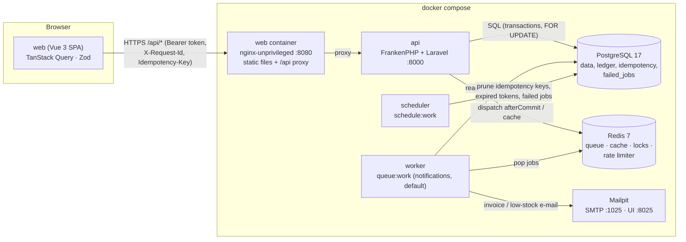

# ARCHITECTURE

Sistem Online Shop (Order Management) — Track B (Laravel 13 + PostgreSQL + Redis) dengan frontend Vue 3.

## 1. Diagram arsitektur



## 2. Struktur layer / modul

```
backend/app
├── Domain/                    ← aturan bisnis murni (tanpa HTTP)
│   ├── Order/OrderStatus.php          tabel transisi (single source of truth)
│   ├── Order/OrderStateMachine.php    satu-satunya jalan mengubah status order
│   ├── Order/OrderTotalCalculator.php fungsi murni: subtotal & total
│   └── Shared/Money.php               nilai uang dalam sen (integer)
├── Services/                  ← use-case yang butuh transaksi / koordinasi
│   ├── OrderService.php               buat order (lock stok, harga server, nomor order)
│   ├── StockService.php               SATU-SATUNYA yang boleh mengubah products.stock + ledger
│   ├── Idempotency/IdempotencyService.php
│   ├── OrderNumberGenerator.php, ReportService.php, DashboardService.php,
│   └── ProductService.php, AuthService.php, InvoiceRenderer.php, AuditLogger.php
├── Http/
│   ├── Controllers/Api/*      ← tipis: validasi → otorisasi → panggil service → resource
│   ├── Requests/*             ← Form Request (validasi + authorize() sebelum validasi)
│   ├── Resources/*            ← bentuk JSON
│   ├── Responses/ApiResponse  ← envelope { success, message, data, meta | errors }
│   └── Middleware/            ← AssignRequestId, ForceJsonResponse
├── Policies/                  ← RBAC (Product, Customer, Order) + Gate laporan
├── Jobs/                      ← ProcessPaidOrder, SendLowStockAlert
├── Exceptions/                ← BusinessRuleException (+ turunan) & ApiExceptionRenderer
└── Models/                    ← Eloquent, $fillable eksplisit
```

**Alasan:**

- **Controller tipis, service tebal.** Semua yang menyentuh lebih dari satu tabel atau butuh lock ada di service, sehingga bisa dipanggil sama persis dari HTTP, seeder, dan test concurrency (test memanggil `OrderService` langsung dari proses hasil fork).
- **Domain murni dipisah** (`OrderStatus`, `OrderTotalCalculator`, `Money`) agar logika paling kritis bisa di-unit-test tanpa database, dan aturan transisi hanya ditulis di satu tempat (dipakai state machine, API `allowed_actions`, dan unit test).
- **"Siapa boleh" vs "boleh dari status ini"** dipisah: Policy menjawab role (403), state machine menjawab status (409). Keduanya selalu dicek di backend; UI hanya menyembunyikan tombol sebagai kenyamanan.
- **Satu pintu untuk stok.** `products.stock` tidak ada di `$fillable` dan `PUT /products/{id}` menolak field `stock`. Semua perubahan lewat `StockService::apply()` yang selalu menulis baris ledger. Akibatnya invariant `SUM(stock_movements.quantity_change) = products.stock` bisa diuji (lihat `StockAndJobsTest`).

Frontend (`frontend/src`): `api/` (client + typed endpoints), `auth/session.ts` (token & forced logout), `router/` (guard role), `composables/useListQuery.ts` (state tabel ↔ URL), `components/OrderForm.vue` (form order yang dites), `pages/*`.

## 3. Model data — perbedaan dari skema acuan

| Perubahan | Alasan |
|---|---|
| Semua timestamp `timestamptz`, disimpan UTC, sesi DB dipaksa `UTC` | Laporan & nomor order dihitung di zona `Asia/Jakarta` tanpa ambigu. |
| `order_items.product_code`, `product_name` (snapshot) | Invoice lama tetap benar meski produk di-rename / di-soft-delete. |
| `order_status_histories` | Kebutuhan "histori status" di detail order + timeline UI. |
| `order_number_sequences (sequence_date, last_number)` | Counter harian atomik untuk `INV-YYYYMMDD-NNNN` (ADR-004). |
| `idempotency_keys` | Desain sendiri, lihat ADR-002. |
| `orders.invoice_sent_at` | Guard idempotensi job invoice. |
| `low_stock_alerts` | Tabel notifikasi admin + guard agar e-mail stok menipis tidak ganda. |
| `audit_logs` (bonus) | Hapus produk, stock adjustment, cancel order. |
| CHECK constraint: `stock >= 0`, `price > 0`, `quantity > 0`, `subtotal = unit_price * quantity`, `stock_after >= 0`, `quantity_change <> 0` | Pertahanan terakhir di database bila ada bug di aplikasi. |
| Partial unique index `stock_movements (reference_type, reference_id, product_id) WHERE type='CANCEL_RESTORE'` | Database menolak pengembalian stok kedua untuk order yang sama. |
| `product_code` unik **termasuk** baris soft-deleted | Kode tidak pernah dipakai ulang, histori order tetap tidak ambigu. |

### Index yang ditambahkan

| Index | Dipakai oleh |
|---|---|
| `orders_report_idx (order_date, status) INCLUDE (total_amount)` | Laporan sales & dashboard: range scan tanggal + filter status, `total_amount` dibaca langsung dari index (index-only scan). |
| `orders (status, order_date)` | Filter list order per status, hitung PENDING/PAID di dashboard. |
| `orders (customer_id, order_date)` | Filter order per pelanggan. |
| `order_items (product_id)` + unique `(order_id, product_id)` | Join top-products & FK; unique mencegah produk ganda dalam satu order. |
| `stock_movements (product_id, id)` | Riwayat ledger per produk, urut terbaru. |
| GIN `pg_trgm` pada `product_name`, `product_code`, `customer_name`, `order_number` | `ILIKE '%kata%'` untuk search tanpa sequential scan. |
| Partial `products (stock, low_stock_threshold) WHERE deleted_at IS NULL` | Hitung produk stok menipis. |
| `idempotency_keys (user_id, scope, idempotency_key)` unique + `expires_at` | Klaim key atomik + pruning. |

Laporan dihitung **satu query per laporan** di PostgreSQL (`GROUP BY`, `generate_series` untuk mengisi periode kosong). Ada test yang memastikan top-products hanya satu query (`ReportAndDashboardTest`). `Model::preventLazyLoading()` aktif di luar production sehingga N+1 langsung gagal di test.

## 4. Architecture Decision Records

### ADR-001 — Strategi konsistensi stok

**Konteks.** Banyak kasir bisa membuat order untuk produk yang sama bersamaan. Tidak boleh overselling, order multi-item harus all-or-nothing, pembatalan harus mengembalikan stok tepat sekali, dan tidak boleh deadlock.

**Opsi.**
1. *Conditional atomic update* — `UPDATE products SET stock = stock - :q WHERE id = :id AND stock >= :q`, cek affected rows. Cepat untuk satu item; untuk multi-item tetap perlu urutan update yang konsisten, dan pesan error per item ("tersisa 3, diminta 5") butuh query tambahan.
2. *Optimistic locking* (`version` column + retry). Bagus saat konflik jarang; untuk "flash sale" produk populer, retry storm membuang kerja dan latensi tidak terprediksi.
3. *Pessimistic lock* — `SELECT … FOR UPDATE` semua produk dalam order, **diurutkan berdasarkan `id`**, lalu validasi & update dalam satu transaksi.

**Keputusan.** Opsi 3 (`StockService::lockProducts()`), ditambah CHECK constraint `stock >= 0` sebagai jaring pengaman. Order dibuat di `OrderService::create()` dalam satu transaksi READ COMMITTED: lock produk (urut id) → validasi seluruh item & kumpulkan semua error → hitung harga dari baris yang dikunci → ambil nomor order → insert order, item, update stok, ledger, histori. Pembatalan (`OrderStateMachine::transition()`) mengunci baris **order** dulu (`FOR UPDATE`) lalu produk dengan urutan id yang sama.

**Kenapa tidak deadlock.** Setiap transaksi mengambil lock produk dalam urutan global yang sama (id naik), sehingga tidak mungkin terjadi siklus tunggu. Ini diverifikasi: dengan lock per item mengikuti urutan dari client, 12 dari 24 transaksi paralel gagal `40P01 deadlock detected`; dengan lock terurut, 24/24 sukses (lihat DECISIONS.md bagian c dan test `does not deadlock when multi-item orders list the same products in opposite order`).

**Konsekuensi.**
- (+) Benar secara sederhana, mudah dijelaskan, error per item akurat karena dihitung dari baris yang terkunci.
- (+) Cancel ganda aman: request kedua menunggu lock order, lalu melihat status `CANCELLED` → 409.
- (−) Produk yang sangat populer menjadi titik serialisasi (throughput per-produk dibatasi durasi transaksi). Transaksi dijaga pendek; untuk skala lebih besar lihat bagian 6.
- (−) Spesifik PostgreSQL/MySQL InnoDB (bukan SQLite) — karena itu test berjalan di PostgreSQL sungguhan.

### ADR-002 — Desain idempotency `POST /api/orders`

**Konteks.** Client (kasir dengan jaringan buruk) bisa mengirim ulang request yang sama. Request ulang tidak boleh membuat order kedua.

**Opsi.** (a) Redis `SET NX` + simpan response di Redis; (b) tabel PostgreSQL; (c) unique constraint "client order id" di tabel orders.

**Keputusan.** Tabel `idempotency_keys` di PostgreSQL (`IdempotencyService`):
- Key **wajib** UUID, discope per `user_id` + endpoint (`orders.create`).
- **Klaim** = satu `INSERT … ON CONFLICT DO NOTHING RETURNING id` (status `processing`), di-commit sendiri sehingga request duplikat langsung melihatnya.
- Pekerjaan bisnis + update record menjadi `completed` (menyimpan status & body response) berjalan dalam **satu transaksi** → order dan penanda idempotensi commit atau rollback bersama. Ini alasan utama memilih PostgreSQL dibanding Redis.
- Fingerprint = SHA-256 dari payload yang sudah divalidasi & dinormalisasi (urutan key JSON, tipe string/angka, huruf besar UUID tidak berpengaruh).
- **Perilaku:**
  - key + payload sama, sudah selesai → response tersimpan diputar ulang (status & body identik) + header `Idempotent-Replayed: true`;
  - key sama, payload beda → **422** (kesalahan client yang tidak akan berhasil bila di-retry — sejalan dengan draft IETF *Idempotency-Key header*);
  - key sama, request pertama masih diproses → **409** + `Retry-After: 1` (konflik sementara, retry akan mendapatkan hasil);
  - request gagal (validasi/stok/exception) → record dihapus, key boleh dipakai lagi karena tidak ada efek samping yang tersimpan;
  - record `processing` yang lebih tua dari 60 detik dianggap yatim (proses crash) dan boleh diambil alih; `lock_token` menjadi *fencing token* agar pemilik lama tidak bisa menimpa.
- **Masa berlaku** 24 jam (`IDEMPOTENCY_TTL_MINUTES`), dibersihkan per jam oleh scheduler (`shop:prune-idempotency-keys`); key kedaluwarsa yang dipakai lagi diperlakukan sebagai key baru.

**Konsekuensi.** (+) Atomik tanpa koordinasi dua sistem; mudah diaudit dengan SQL. (−) Satu insert + satu update ekstra per order; tabel perlu pruning. Frontend membuat key baru per percobaan submit dan memakai key yang sama untuk retry otomatis saat network error/409.

### ADR-003 — Strategi autentikasi

**Konteks.** Track B mensyaratkan Laravel Sanctum (API token) dengan expiry dan revoke saat logout; SPA adalah service terpisah.

**Opsi.** (a) Sanctum SPA cookie (session + CSRF, cookie httpOnly); (b) Sanctum personal access token (Bearer); (c) JWT access + refresh.

**Keputusan.** (b) Bearer token Sanctum:
- token dibuat saat login dengan `expires_at` = sekarang + 8 jam (`AUTH_TOKEN_TTL_MINUTES`), juga dibatasi `sanctum.expiration`;
- logout menghapus **token yang sedang dipakai** (perangkat lain tetap login); token kedaluwarsa dibersihkan harian (`sanctum:prune-expired`);
- login: rate limit 5/menit per email+IP dan 30/menit per IP, pesan error generik, waktu respons dibuat sama untuk email tidak terdaftar (dummy bcrypt) untuk mencegah user enumeration;
- di frontend token disimpan di memori + `sessionStorage` (hilang saat tab ditutup), timer logout otomatis saat `expires_at`, dan **logout paksa** pada 401 apa pun.

**Konsekuensi.** (+) API stateless, mudah dipakai client lain (mobile/POS), CORS tanpa credential (`supports_credentials=false`, origin di-whitelist eksplisit). (−) Token bisa dibaca JavaScript → mitigasi XSS penting (Vue meng-escape output, tidak ada `v-html`, header keamanan di nginx). Bila dibutuhkan, beralih ke mode cookie Sanctum adalah perubahan di layer auth saja. Tidak ada refresh token (sesuai Track B) — user login ulang setelah 8 jam.

### ADR-004 — Nomor order `INV-YYYYMMDD-NNNN`

Counter per hari bisnis (Asia/Jakarta) di tabel `order_number_sequences` dengan `INSERT … ON CONFLICT DO UPDATE SET last_number = last_number + 1 RETURNING`, dipanggil **di dalam** transaksi order setelah validasi stok lolos. Unik (unique index + baris counter terkunci sampai commit), tanpa celah saat rollback, tanpa round-trip ke Redis. Trade-off: semua order pada hari yang sama serial pada baris counter selama sisa transaksi (jangka pendek); untuk multi-cabang lihat bagian 6.

### ADR-005 — Representasi uang

Kolom `decimal`, di PHP dibaca sebagai string dan dihitung sebagai integer sen (`Money`), di JSON dikirim sebagai string `"12000.00"`, di frontend dihitung dalam sen. Tidak ada float di jalur perhitungan uang.

### ADR-006 — Background job yang aman dijalankan ulang

`ProcessPaidOrder` di-dispatch dengan `afterCommit()` (worker tidak pernah melihat order yang PAID-nya di-rollback), `ShouldBeUnique` + `WithoutOverlapping` per order, `tries=5` dengan backoff `[10, 30, 90, 300]` detik, `failed()` mencatat error dan job tersimpan di `failed_jobs` untuk `queue:retry`. Guard `invoice_sent_at` membuat eksekusi ulang menjadi no-op. Sisa risiko: crash tepat setelah SMTP menerima e-mail tetapi sebelum `invoice_sent_at` tersimpan → satu duplikat (at-least-once); Message-ID dibuat deterministik per order agar bisa di-dedup. Job stok menipis memakai `low_stock_alerts` (unique per stock movement) dengan pola yang sama dan hanya terpicu ketika stok **melewati** batas (bukan setiap penjualan di bawah batas).

## 5. Cache, keamanan, observability

- **Cache dashboard** (`DashboardService`): cache-aside di Redis, key `dashboard:summary:v1`. Invalidasi eksplisit **setelah commit** pada setiap penulisan yang mengubah angkanya (order dibuat, transisi status, stock adjustment, CRUD produk/pelanggan) + TTL pendek (300 detik) sebagai jaring pengaman untuk race "reader menghitung dari snapshot lama tepat sebelum commit".
- **Security**: RBAC di Policy/Gate/FormRequest::authorize (403 dicek sebelum validasi), rate limit login & pembuatan order, CORS whitelist eksplisit, `$fillable` eksplisit + `preventSilentlyDiscardingAttributes` di non-production, harga/total dari client ditolak (`prohibited` dan `items.*` hanya boleh `product_id, quantity`), tidak ada secret di repo (APP_KEY dibuat container saat boot pertama), error 500 tanpa stack trace saat `APP_DEBUG=false`, image tidak berjalan sebagai root.
- **Observability**: log JSON ke stderr; `X-Request-Id` diterima (bila formatnya aman) atau dibuat server, dikembalikan di response, dan dimasukkan ke Laravel `Context` sehingga ikut di setiap log **dan** di job yang di-dispatch dari request tersebut; satu access-log terstruktur per request (method, path, status, durasi, user); `GET /api/health` memeriksa PostgreSQL & Redis (200/503).

## 6. Jika harus melayani 50.000 order/hari dari banyak cabang

50.000/hari ≈ 0,6 order/detik rata-rata, tetapi puncak (jam makan siang, promo) bisa 20–50×. Yang akan saya ubah, berurutan dari yang paling berdampak:

1. **Stok per cabang.** Tabel `branch_stocks (branch_id, product_id, stock)`; lock menjadi per (cabang, produk) sehingga cabang tidak saling menunggu. Ledger mendapat `branch_id`. Ini juga menghilangkan hot row terbesar.
2. **Nomor order per cabang**: `INV-{BRANCH}-{YYYYMMDD}-{NNNNN}` dengan counter per (cabang, tanggal) → tidak ada lagi satu baris counter global.
3. **Hot product / flash sale**: untuk SKU yang sangat diperebutkan, reservasi stok di Redis (Lua script decrement atomik) dengan rekonsiliasi asinkron ke PostgreSQL, atau antrian order per SKU. Hanya untuk SKU tertentu — jalur normal tetap transaksi SQL.
4. **Reservasi dengan kedaluwarsa**: order PENDING yang tidak dibayar dalam N menit dibatalkan otomatis oleh scheduler sehingga stok tidak "terkunci" selamanya.
5. **Database**: PgBouncer (transaction pooling), read replica untuk list/laporan, partisi `orders`/`order_items`/`stock_movements` per bulan, dan tabel ringkasan harian (materialized/rollup per cabang) diisi job agar laporan tidak scan data mentah.
6. **Aplikasi**: Laravel Octane (FrankenPHP worker mode) + autoscaling horizontal stateless, Horizon untuk memantau & menskalakan worker per queue, queue terpisah untuk e-mail vs proses kritis.
7. **Event & integrasi**: outbox table (ditulis dalam transaksi order) → event `OrderPaid`, `StockLow` ke message broker untuk sistem lain (gudang, akuntansi), menggantikan dispatch langsung.
8. **Observability**: OpenTelemetry tracing (request_id → trace_id), metrik Prometheus (latensi pembuatan order, lock wait time, deadlock count, panjang queue, rasio 409/422), alert SLO.
9. **Offline-first di kasir**: idempotency key sudah ada, sehingga POS bisa menyimpan order lokal saat offline dan mengirim ulang dengan aman.

## 7. Decisions

Jawaban empat pertanyaan wajib (stok minus saat order bersamaan, struktur folder, bug yang ditemui, bagian yang belum selesai) ada di [DECISIONS.md](./DECISIONS.md).
